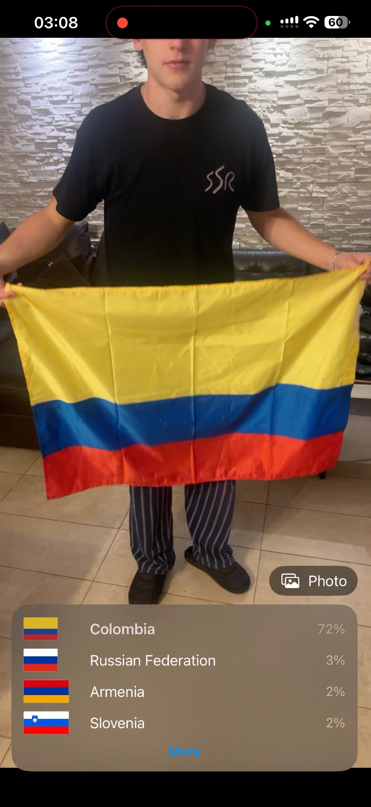
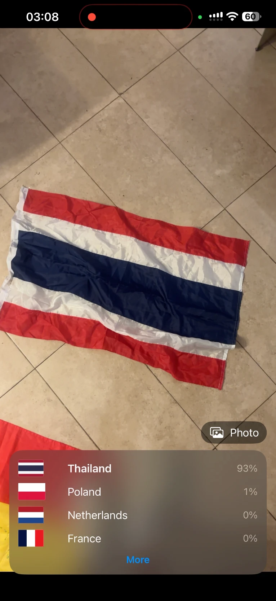
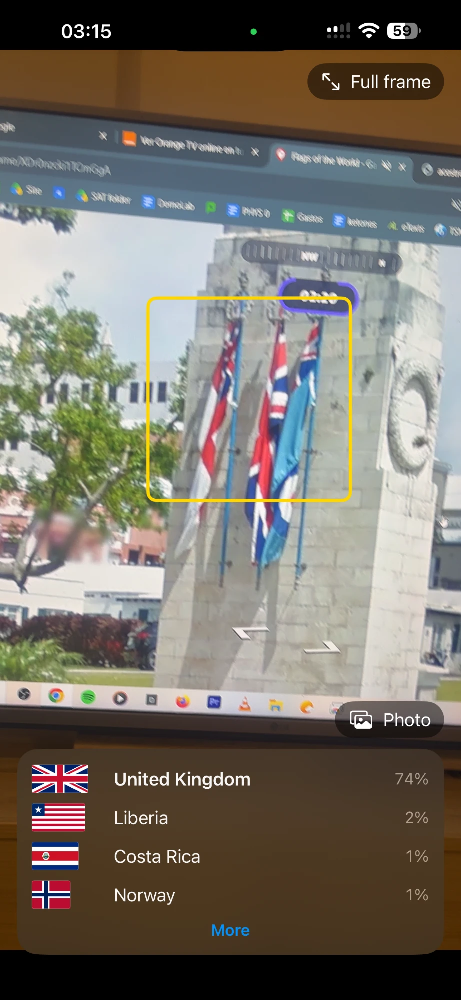
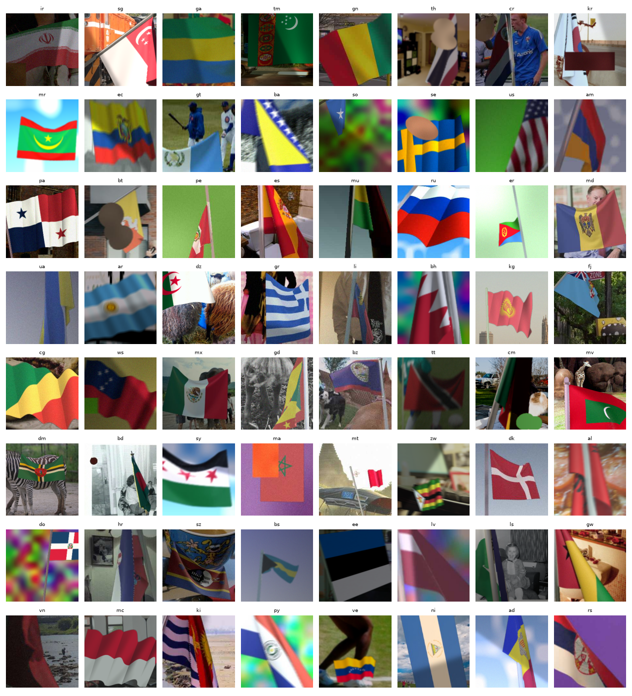

# FlagID: recognising country flags on an iPhone

You point your iPhone at a flag and get a live, ranked list of which country it is. A
flag classifier for 195 countries, trained **only on synthetic images**, runs on the device
in a SwiftUI app. Nothing is sent over the network.

  
  
  

Screenshots from an iPhone 15 Plus. The right-hand one uses tap-to-focus (yellow box)
to pick one flag out of a group. More in <a href="app_screenshots/">app_screenshots/</a>.

## Highlights

- **Synthetic training data only.**
  - Flag SVGs are draped over a library of cloth shapes simulated in Blender: sleeves,
    grommets or held corners, with wind and tilted poles.
  - They are lit, occluded and pasted onto COCO and procedural backgrounds.
  - No real flag photos are used for training.
- **MobileNetV3, exported to Core ML.** The int8 model is 4.5 MB and takes under 1 ms per
  image on an M1 Pro's Neural Engine.
- **Real-photo accuracy:** 80% top-1 and 92% top-4 on 126 real photos of 18 countries. On
  synthetic validation images, top-1 is 98%. The real test set is deliberately hard, with
  some very small or barely visible flags, so in everyday use the app does better than
  these numbers.
- **Lookalike groups:** Ireland / Côte d'Ivoire, Mali / Guinea, Chad / Romania and
  Indonesia / Monaco are near-identical, so each pair is one entry (191 entries in all).
- **iOS app:**
  - 24 fps camera preview, with the model running about 5 times a second off the main thread.
  - Time-based smoothing, so the list doesn't flicker.
  - Tap-to-focus crop for small or distant flags, pinch to zoom, and a photo picker.
  - 31 unit tests.
- **Adding flags without retraining (experiment).** Spain's 19 regional flags were compared
  with the model's image features instead of its trained classes. All 19 land in the top 4
  on synthetic images (92% top-1), and the model never saw them in training.

  
   Synthetic training samples from the v3 generator.

## Repository layout

| Path | What it is |
|---|---|
| [`flagid/`](flagid/) | The model, in Python and PyTorch: data preparation, synthetic image generator, Blender cloth simulation, training, evaluation and Core ML export. Each experiment is written up with results in [`flagid/README.md`](flagid/README.md). |
| [`FlagLogApp/`](FlagLogApp/) | The iPhone app: SwiftUI, Vision and Core ML, iOS 17+, no dependencies. See [`FlagLogApp/README.md`](FlagLogApp/README.md). |
| [`app_screenshots/`](app_screenshots/) | Screenshots from a real iPhone. |

## Quick start

**App:** open `FlagLogApp/FlagLog.xcodeproj` in Xcode, set your signing team and run it on an
iPhone. The trained model is included (`FlagLogApp/FlagLog/Model/FlagID.mlpackage`). In the
simulator, use **Photo** with the images in `FlagLogApp/TestImages/`.

**Model:** see [`flagid/README.md`](flagid/README.md) for setup and for each stage: data,
training, evaluation and export. The datasets, the cloth-simulation library (about 6 GB in
all) and the PyTorch checkpoints are not in the repo; the README's commands regenerate
them. The real-photo test set is private and not included.

## How it works

1. **Data.** Flag SVGs come from Wikimedia Commons (public domain) and are rasterised.
   Backgrounds are COCO val2017 photos plus procedural skies, walls and noise.
2. **Cloth library.** Blender simulates blank cloths in many setups: attachment, wind, pole
   angle and camera. The flags are mapped onto these shapes in Python, so the library
   doesn't grow with the number of flags.
3. **Generator.** Each sample drapes a flag, then adds perspective, lighting, occlusion
   (poles, hands, heads), blur, noise and JPEG artefacts. A fresh set is generated each epoch.
4. **Training.** A timm MobileNetV3 is trained with AdamW, label smoothing and cosine decay:
   30 epochs, about 2 hours on an M1 Pro (MPS).
5. **Evaluation.** The headline metric is top-4 on real photos, since the app shows four
   rows. The detailed results are in [`flagid/README.md`](flagid/README.md).
6. **Export.** fp16, int8 and palettized variants are compared against PyTorch, checking
   that their predictions match. The smallest one that keeps accuracy is shipped (int8).
   Display names and lookalike groups are stored in the model's metadata, so a new model
   can be swapped into the app with no code change.

## Roadmap

- **Collection:** pick the flag you're seeing from the live list and tap **Collect** to
  unlock a short article on it (history, meaning, facts) and its earlier versions.
- **Model:** keep improving accuracy and add more flags, such as regional packs.
